<!-- cards:start -->

<a href="https://yourportfolio.com">portfolio</a> / <a href="https://linkedin.com/in/abdul-mannan-537494375">linkedin</a> / <a href="mailto:abdulmannan010spn@gmail.com">email</a>

<!-- cards:end -->
