<!--REPOS:START-->

<!--REPOS:END-->

<a href="https://yourportfolio.com">portfolio</a> / <a href="https://linkedin.com/in/abdul-mannan-537494375">linkedin</a> / <a href="mailto:abdulmannan010spn@gmail.com">email</a> / <a href="https://github.com/abdulmannan010spn-bot">github</a>

