

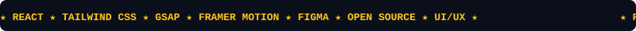

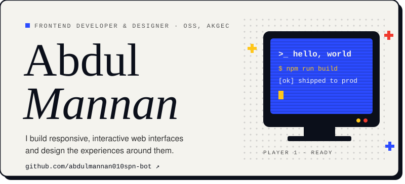

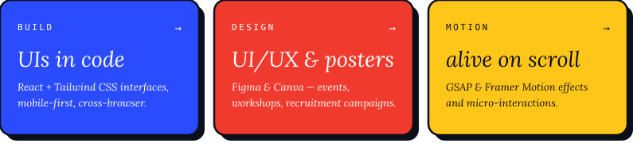

<a href="https://3-d-portfolio-pied-three.vercel.app/">portfolio</a> /
<a href="https://linkedin.com/in/abdul-mannan-537494375">linkedin</a> /
<a href="https://github.com/abdulmannan010spn-bot">github</a> /
<a href="mailto:abdulmannan010spn@gmail.com">email</a>

  

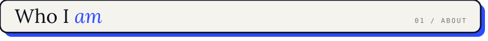
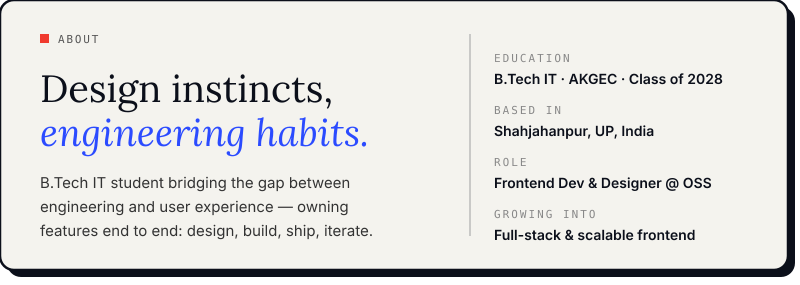

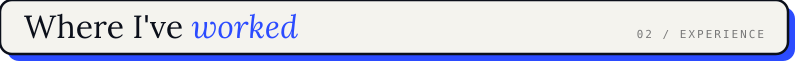
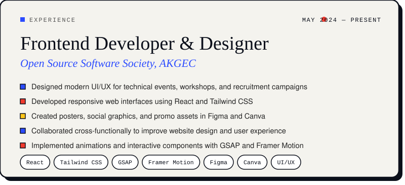

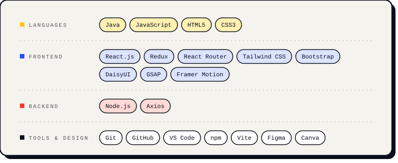

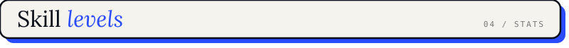
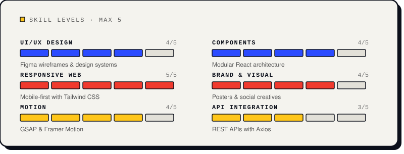

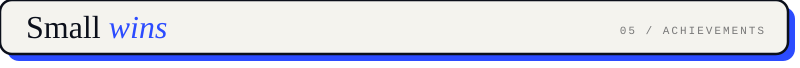
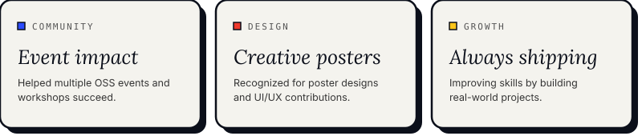

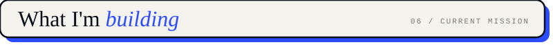
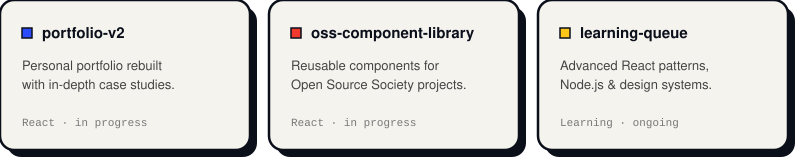

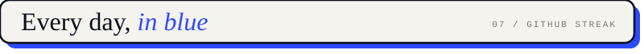

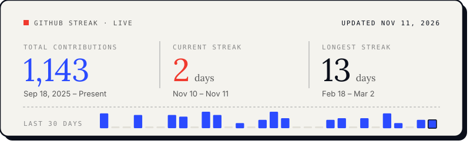

 

 

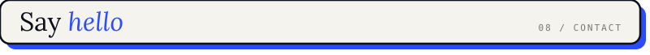
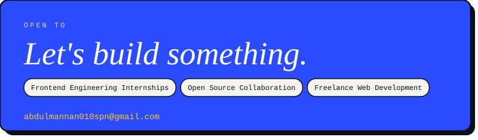

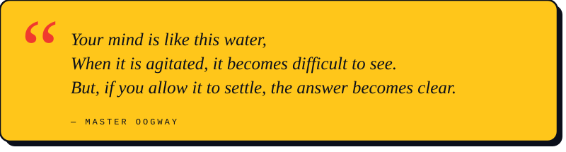

